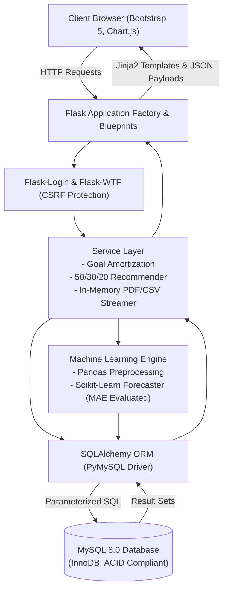
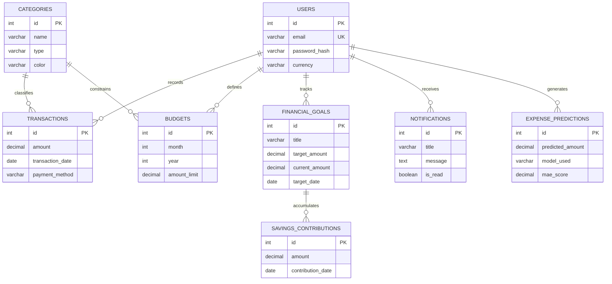

# AI-Based Personal Budget Planning & Financial Goal System
**Master of Computer Applications (MCA) Final Academic Project**  
*A Full-Stack Personal Finance, Predictive Budgeting & Milestone Savings Web Application*

---

## 🌟 Executive Overview
The **AI-Based Personal Budget Planning & Financial Goal System** is a full-stack web application developed using **Python (Flask)** and **MySQL 8.0**. Designed to address impulsive consumer spending and fragmented personal financial records, the application integrates transaction ledger accounting, real-time category budget enforcement, automated milestone savings goal amortization, and machine learning expenditure forecasting into a secure, multi-tenant platform.

---

## 🛠️ Technology Stack

| Layer | Technologies Used |
|---|---|
| **Backend Framework** | Python 3 (3.10+ / 3.14), Flask 3.1.3, Flask-Login, Flask-WTF, Werkzeug |
| **Database & ORM** | MySQL 8.0 Server (InnoDB Storage Engine, 3NF Normalized), Flask-SQLAlchemy 3.1.1, Flask-Migrate 4.1.0 (Alembic) |
| **Machine Learning & AI** | Scikit-Learn 1.9.1 (Linear Trend Regression, Regularized Ridge Regression), Pandas 3.1.0, NumPy 2.5.4 |
| **Presentation Tier** | HTML5, CSS3, JavaScript, Bootstrap 5.3, Bootstrap Icons, Chart.js 4.4 |
| **Reporting & Export** | ReportLab 5.1.0 (In-Memory PDF Generation), RFC 4180 CSV Engine |
| **Testing & Security** | Pytest 9.1.1 (49 Automated Test Cases), CSRFProtect, PBKDF2 Password Hashing |

---

## 📐 System Architecture



---

## 🚀 Key Functional Modules

1. **Authentication & Session Isolation:** Secure registration, PBKDF2/SHA-256 password hashing, session cookies, and strict `@login_required` route protection.
2. **Executive Cockpit Dashboard:** Month-to-date (MTD) Income, Expenses, Net Balance, Savings Rate %, recent activity ledger, active goals, and Chart.js feeds.
3. **Income Management:** Track earnings across salary, freelance, investments, and gifts with date filtering.
4. **Expense Management:** Detailed logging with categories, payment modes (Cash, UPI, Debit Card, Credit Card, Net Banking), and server-side positive amount validation.
5. **Monthly Budget Planner:** Real-time category utilization tracking with automated color-coded alerts (Green: Safe, Yellow: $\ge 80\%$ Near Cap, Red: $\ge 100\%$ Breached).
6. **Financial Goal Amortization:** Target savings milestones with automated monthly contribution calculations:
   $$S_{\text{monthly}} = \frac{\text{Target} - \text{Current}}{\text{Months Remaining}}$$
7. **Expense Analytics Engine:** Month-over-Month (MoM) spending variance, top-5 spending categories, and 6-month historical cash flow trends.
8. **AI/ML Expense Forecasting:**
   - **Tier 1 (Cold-Start $<3$ mos):** Moving average baseline with honest transparency disclosures.
   - **Tier 2 ($3-5$ mos):** Scikit-Learn Linear Trend Regression.
   - **Tier 3 ($6+$ mos):** Scikit-Learn Regularized Ridge Regression with lag ($t-1$) and cyclical seasonal features ($\sin/\cos$).
   - **Evaluation:** Evaluated via **Mean Absolute Error (MAE)** in exact currency units ($\pm ₹$).
9. **Smart Savings Recommendations:** Heuristics grounded in the **50/30/20 budget framework** (Needs / Wants / Savings) and runaway category velocity detection.
10. **Reports & Data Export:** Date-filtered audit statements exportable as in-memory RFC 4180 CSV files or publication-grade ReportLab PDF documents.
11. **Profile & Customization:** Global currency preference switcher (default: `₹` INR, customizable to `$`, `€`, `£`) and secure password change.

---

## 🗄️ Database Entity-Relationship Schema



---

## 💻 Installation & Setup Guide (Windows / VS Code)

### Prerequisites
- Python 3.10+ installed
- MySQL Server 8.0 running on `localhost:3306`

### 1. Open Project Directory
```powershell
cd C:\Users\chokh\.gemini\antigravity\scratch\ai_budget_planner
```

### 2. Activate Virtual Environment
```powershell
.\venv\Scripts\Activate.ps1
```
*(If execution is disabled, run: `Set-ExecutionPolicy -Scope Process -ExecutionPolicy Bypass`)*

### 3. Verify Environment Variables (`.env`)
Ensure `.env` matches your local MySQL setup:
```ini
SECRET_KEY=dev-secret-key-ai-budget-planner-mca-2026-9f8e7d6c5b4a
FLASK_ENV=development
DB_USER=root
DB_PASSWORD=root
DB_HOST=localhost
DB_PORT=3306
DB_NAME=ai_budget_db
DEFAULT_CURRENCY=₹
```

### 4. Run Automated Test Suite (49 Tests)
```powershell
pytest
```
*Expected Result:* `49 passed in ~40s (100% pass rate)`

### 5. Launch Application Server
```powershell
python run.py
```
Open your browser at **`http://127.0.0.1:5000`**

---

## 🧪 Automated Testing Matrix

| Test Suite | Tests | Purpose | Result |
|---|---|---|---|
| `tests/test_environment.py` | 3 | Python version & package imports | **PASSED** |
| `tests/test_models.py` | 6 | 3NF constraints, password hashing, decimal precision | **PASSED** |
| `tests/test_auth.py` | 7 | Registration, duplicate rejection, session login/logout | **PASSED** |
| `tests/test_transactions.py` | 6 | Income/expense CRUD, negative amount validation, IDOR check | **PASSED** |
| `tests/test_budgets_and_goals.py`| 5 | 80%/100% alerts, goal amortization formulas, completion | **PASSED** |
| `tests/test_dashboard_and_analytics.py` | 6 | MTD math, savings rate, 6-month trend, category donut | **PASSED** |
| `tests/test_ml_and_recommendations.py` | 5 | Cold-start baseline, Scikit-learn regression, 50/30/20 rule | **PASSED** |
| `tests/test_reports_and_profile.py` | 6 | CSV export, ReportLab PDF `%PDF` header, profile updates | **PASSED** |
| `tests/test_qa_and_security.py` | 5 | Unauthorized access, custom 404, empty dataset resilience | **PASSED** |
| **TOTAL** | **49** | **Complete Full-Stack Verification** | **100% PASSED** |

---

## 🌐 Linking to Your GitHub Repository

To push this implementation to your GitHub account:

1. Create a new, empty repository on GitHub named `ai-budget-planner` (do not initialize with a README).
2. Link your local repository to GitHub:
   ```powershell
   git remote add origin https://github.com/<your-username>/ai-budget-planner.git
   git branch -M main
   git push -u origin main
   ```
3. Your full commit history (Phases 1 through 12) will be preserved!

---

## 🎓 Academic Viva Demonstration Script

When presenting to evaluators, follow this workflow:
1. **Introduction:** State the problem statement and highlight your 3-tier architecture.
2. **Registration & Auth:** Register a test account. Explain PBKDF2 password hashing and CSRF tokens.
3. **Transaction Accounting:** Log an income entry (₹50,000) and an expense entry (₹4,200). Explain why `DECIMAL(12,2)` was chosen over `FLOAT`.
4. **Budget Alerts:** Show a monthly budget cap of ₹5,000. Point out the warning alert triggered at 84%.
5. **Goal Amortization:** Demonstrate creating a goal (e.g. ₹60,000 in 6 months). Show the live calculation: $\frac{60,000}{6} = \text{₹10,000/month}$. Deposit a contribution and observe real-time progress.
6. **AI/ML Forecasting:** Navigate to **"AI Insights"**. Explain the cold-start fallback strategy and why MAE was chosen over MSE.
7. **Reporting & PDF:** Open **"Reports"** and click **"Download PDF"**. Open the generated file to showcase the in-memory ReportLab statement.
8. **Codebase Defense:** Run `pytest` directly in your terminal to prove that all 49 automated test cases pass with zero errors!

---

## 📄 License & Attribution
This project is developed for academic evaluation in partial fulfillment of the Master of Computer Applications (MCA) degree. All source code is original and adheres to open-source licenses of the underlying libraries (Flask, Scikit-Learn, ReportLab, Bootstrap 5).
